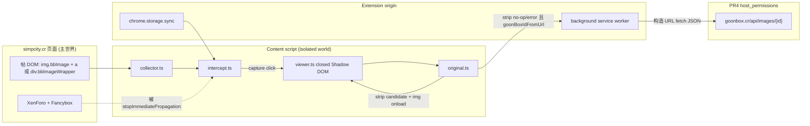
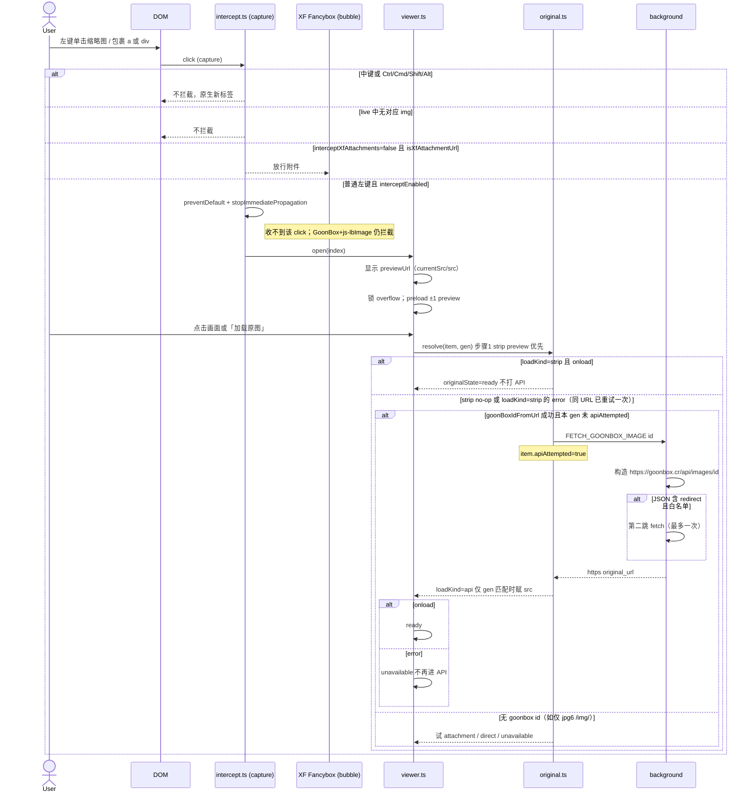
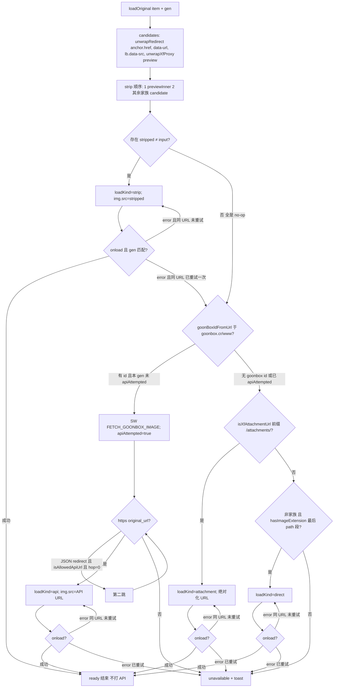

# GoonView 设计文档：页内 Telegram 风格图片查看器（Chrome/Edge MV3）

| 字段 | 值 |
| --- | --- |
| **文档标题** | GoonView — in-page Telegram-style image viewer |
| **产品** | GoonView 浏览器扩展 |
| **作者** | TBD |
| **日期** | 2026-09-19 |
| **状态** | Draft（rev 4：overlay 新标签按钮 + 滚轮缩放拖动；pixhost/imgbox v1 不做专用解析） |
| **仓库** | `E:\project\goonview`（当前为空的 greenfield） |
| **目标平台** | Chrome / Edge，Manifest V3 |
| **文档语言** | 中文（代码标识符、URL、CSS 选择器、文件路径保持英文） |

---

## Overview

用户在 `https://simpcity.cr` 浏览帖子时，帖内已经以缩略图形式展示的图片（`img.bbImage`）在左键单击后会导航到图床页，当前以 **GoonBox**（`https://goonbox.cr/img/{encoded_id}`，Chevereto 家族；亦见 SEO 形态 `/img/{slug}.{id}`）为主。外链经常被 XenForo 改写成 `https://simpcity.cr/redirect/?to=<base64url>`。论坛自带 Fancybox lightbox（`xf/lightbox-compiled.js`，`.js-lbImage`）只覆盖 **本站附件**；外链图床几乎不进 lightbox，于是浏览器直接打开新标签。

包裹 markup **有两种**，实现不得只认 `<a>`：

1. 外链常见：`<a class="bbImageWrapper" href="...">` 包住 `img.bbImage`（href 可能是图床页、直链 thumb、或 `/redirect/?to=`）。也可能 **A 外包 DIV**：`<a href="https://goonbox.cr/img/…"><div class="bbImageWrapper js-lbImage">…`——`anchor` 与 `lb` 必须分开取，不能 `closest(a, div)` 只拿到内层 DIV。
2. XF 附件常见（stock `lightbox_macros`）：**`<div class="bbImageWrapper js-lbImage" data-src="{$src}">`**，内含 ``，**没有 href**。`data-url` / 包裹 `data-src` 是 lightbox **原图候选**，不是已经画在屏幕上的预览像素。

GoonView 是一个 **Manifest V3 内容脚本优先** 的 Chrome/Edge 扩展：只注入 `https://simpcity.cr/*`（v1 **不含** `www.simpcity.cr`），在捕获阶段拦截已采集缩略图及其包裹节点的普通左键，阻止导航与 XF lightbox，在 **当前标签** 用 **closed** Shadow DOM 的暗色 overlay 查看。默认展示 **已经加载的预览**（`img.currentSrc || img.src`，**不用** `data-url` / 包裹 `data-src`）；用户通过「加载原图」按钮或（未放大时）点击画面再解析原图 URL。Overlay 工具栏有 **「在新标签打开」** 按钮（Font Awesome Free 的 `arrow-up-right-from-square` 内联 SVG，不加载 webfont/CDN）：这是离开当前帖的显式逃生舱，普通左键不再承担该职责。滚轮缩放（1×–8×），放大后可拖动平移。图库范围 = **当前文档里已经渲染出来的** `.message-userContent img.bbImage`。左/右键与方向键在该集合内循环切换。原图解析：**先**对家族 host 的 preview 去 Chevereto 尺寸后缀；仅 goonbox 主机才打 API。jpg6/jpg7 **只 strip、不打 goonbox API**。「href 带图片扩展名」**不能**证明它不是 thumb。v1 **不为** pixhost.to / imgbox.com 做 HTML 抓取（见 Host coverage）。

---

## Background & Motivation

### 当前行为（痛点）

1. **左键 = 离开当前帖**。包裹链接指向 `goonbox.cr/img/...` 或 `/redirect/?to=...`，普通单击打开新标签（常见为 GoonBox 图页），阅读上下文丢失。
2. **XF 原生 lightbox 覆盖不全**。`js-lbImage` + `data-fancybox` 对 `/attachments/...` 有效；外链 `<a href>` 指向图床页面而非直链，Fancybox 不会收录，用户得到的是导航而不是查看器。
3. **带宽浪费风险**。帖内缩略图已经在 HTTP 缓存里；若打开查看器就自动拉 1–8MB 原图，50–200 张的长帖会迅速打满流量。产品要求：**打开只显示预览，原图按需**。
4. **已有工具不对齐 Telegram UX**（见 Prior Art）。用户明确要求：留在原标签、卡片/全屏 overlay、当前页缩略图图库、左右切换、显式加载原图。

### 站点事实（已核实 vs 待 PR2 对着实页冻结）

下列 markup / API 来自 XenForo 模板、SimpCity Plus、gallery-dl、cyberdrop-dl 与用户提供的核实项。**本环境未能抓取 live `simpcity.cr` HTML。** 选择器、spoiler 展开 class、是否走 `proxy.php`、GoonBox 是否发 SEO `/img/{slug}.{id}` 或 JSON `{redirect}`，一律在 **PR2 验收**（一张 GoonBox 缩略图、一张 XF 附件、一组折叠/展开 spoiler、一条 `/redirect/?to=` 的截图或 HAR）之后才能视为冻结。PR2 之前把本文选择器当「工作假说」，发现冲突以实页为准并回写本文。

**SimpCity（XenForo 2）**

- 域名（v1 matches）：`https://simpcity.cr`（apex only，见 D2 / D11）
- 帖正文容器：`.message-userContent.lbContainer.js-lbContainer`
- 展示图：`img.bbImage`
- 包裹 A：`<a class="bbImageWrapper" href="...">`，偶发同时带 `js-lbImage`
- 包裹 DIV（附件 stock 模板）：`<div class="bbImageWrapper js-lbImage" data-src>` + `img.bbImage[data-url]`
- 原生 lightbox：Fancybox，`xf/lightbox-compiled.js`，`.js-lbImage`，`data-fancybox`
- 外链跳转：pathname 为 `/redirect` 或 `/redirect/` 的 `?to=<base64url>`，`atob(to)` 得到真实 URL
- 附件 URL：`/attachments/...`，或 DIV 包裹上的 `data-src` / `img[data-url]`
- 可能的图片代理：`/proxy.php?image=<urlencoded url>`（Plus 假定 raw CDN `img.src`；若实页走 proxy，D6 必须先解包再认家族 host）
- 必须排除：头像、smilies、UI chrome

**GoonBox（Chevereto 家族，当前主图床）**

- 图页：`https://goonbox.cr/img/{encoded_id}` 或 SEO `https://goonbox.cr/img/{slug}.{encoded_id}`（id = 该 path 段 **最后一个** `.` 分隔 token，与 cyberdrop-dl / gallery-dl 一致）
- 相册：`https://goonbox.cr/a/{id}`（v1 不爬相册、不注入该域；若某张 **已显示的缩略图** 包裹 href 是相册，仍拦截打开 overlay，修饰键才导航）
- 公开 JSON：`GET https://goonbox.cr/api/images/{id}`
  - 成功：`{ image: { original_url, thumb_url?, mime?, original_filename?, encoded_id?, url? } }`
  - 或 JSON 体重定向（**不是** HTTP 3xx）：`{ redirect: string }`。只允许再 fetch **同一 API 白名单** 内的 URL，最多一跳
- CDN 示例：`https://simp6.cuckcapital.cr/images4/<uuid>.jpg`；thumb 与 original 文件名可能完全不同（去后缀 404 时必须回落到 API）
- 后缀约定（jpg.church 谱系 / cyberdrop-dl / SimpCity Plus）：从 **pathname 文件名** 去掉 `.th.` / `.md.` / `.fr.` 得到候选源图。SimpCity Plus 对 goonbox/jpg6/jpg7/selti-delivery 使用 `image.src.replace(".md", "")`——我们 **不复制** 该字符串替换，只复制意图
- 历史同族域（`isFamilyHost` 含 apex 与子域，含 `www`）：`goonbox.cr`、`cuckcapital.cr`、`jpg.church`、`jpg6.su`、`jpg7.cr`、`host.church`、`selti-delivery.ru`（Plus 实见 `simp4.selti-delivery.ru` / `simp6.selti-delivery.ru`）

**XenForo spoiler（用于 D3 扫描边界）**

标准 spoiler 结构为 `.bbCodeSpoiler` > `.bbCodeSpoiler-button`（`data-xf-click="toggle"`）+ 兄弟 `.bbCodeSpoiler-content` > `.bbCodeBlock--spoiler`。折叠态内容仍在 DOM 中。v1 **不把折叠 spoiler 内的图算进图库**，展开后再 rescan。`is-active` 落在 content、button 还是根节点 **未在实页验证**；PR2 必须 dump 一对折叠/展开节点，禁止在热路径用 `getComputedStyle` 猜。

### Prior art（分化，不复制产品形态）

| 项目 | 做法 | 与本产品的差异 |
| --- | --- | --- |
| **SimpCity Plus** userscript（gist `Ecks1337/66e894252f9fbcc909c6bff86f615826`） | 把包裹 `href` 改成原图 URL，绑到 XF Fancybox；只处理 `parent.tagName === "A"` | 不是 Telegram UX；依赖页面 lightbox CSS/JS；没有「先预览再加载原图」；会漏掉 DIV `bbImageWrapper` |
| **Simpcity Gallery Viewer**（Firefox） | 工具栏打开的整帖 Google Photos 式网格，含其他分页 | 用户要的是 **页内点击 overlay**，不是独立图库 App，v1 不爬分页 |
| **Compact Thumbs** userscript | 在帖内把大图展开；改写 `img.src` | 不是带左右切换的 gallery overlay |
| **Telegram Desktop/Web media viewer** | 暗色 overlay、`object-fit: contain`、计数、箭头、Esc、可选原图质量、打开时锁滚动、滚轮缩放与拖动 | **UX 参考**，不是协议或代码来源 |

### Host coverage：GoonBox vs pixhost / imgbox（2026-09 调研）

用户观察：当前帖里图片「基本都转向 goonbox」。公开证据与此一致，**不足以**为 pixhost/imgbox 单独加 `host_permissions` + HTML 抓取。

| 信号 | 含义 |
| --- | --- |
| gallery-dl #9615（2026-06-27） | 「SimpCity has migrated image hosting from jpg6.su to goonbox.cr」——**新帖默认图床已换**，不是 jpg6，更不是 pixhost |
| SimpCity Video & Image Link Copier v2.9（2026-06-28） | changelog 加 goonbox 域，不再把 pixhost 当主路径 |
| FreeInternet-Media 1.8.0（更新 2026-08-19） | `@match` 是 SimpCity 各 TLD + **goonbox.cr** + Bunkr；**没有** pixhost.to / imgbox.com |
| gallery-dl #9364（2026-04-03） | 旧帖仍能见到 `t1.pixhost.to/thumbs/...` + `/redirect/?to=` 包 `pixhost.to/show/...`。这是 **历史帖存量**，不是 2026 年中以后的发帖默认 |
| SimpCity Plus | 仍 special-case pixhost（抓 `#image`）和 imgbox（抓 `#img`），因为老帖还在 |
| imgbox.com | 2026-07 服务器因同机柜调查下线；社区指南写 DO NOT USE；Semrush 2026-08 访问量环比 −59.55%。**新上传路径已死** |
| pixhost.to | 图床本身仍在运营（第三方流量统计仍有日访），但 **SimpCity 新内容管线已不指向它** |

**v1 决定（关闭 Open Question 1）：**

- **不做** pixhost / imgbox 的 HTML 抓取，**不**申请这两家 `host_permissions`。
- 它们的 `img.bbImage` **仍然进图库**（preview = 已显示的 `src`，例如 `t1.pixhost.to/thumbs/...`）。左右切、滚轮缩放都可用。
- 「加载原图」走 D6 通用路径：无家族后缀、无 goonbox id、无 `/attachments/` 时，若 href 不像直链图片 → `unavailable`，**不导航**。用户用工具栏「在新标签打开」落到 `pixhost.to/show/...` 自己看。
- PR2 debug overlay 增加 **host 直方图**（按 `previewUrl` / `unwrappedHref` 的 hostname 计数）。若实帖里 pixhost 占比意外 >10%，再开后续 PR，而不是 v1 预支权限。

---

## Goals & Non-Goals

### Goals（v1）

- 在 `https://simpcity.cr/*` 上，普通左键打开 **当前标签内** 的全屏能力图片卡片，不导航、不新开标签。
- 图库 = 当前文档已渲染的 `.message-userContent img.bbImage`（见 D3），DOM 顺序，左右循环切换。
- 默认显示已加载预览；显式「加载原图」后才解析并请求原图像素。
- Overlay 工具栏 **「在新标签打开」** 按钮（`arrow-up-right-from-square` 内联 SVG）显式跳到新标签；帖内普通左键不承担此职责。
- Overlay 内 **滚轮缩放**，放大后 **拖动平移**（见 D12）。
- 与 XF Fancybox **互斥**：我们拦截的点击不得双重打开。
- 中键 / Ctrl / Cmd / Shift+点击保留浏览器原生「新标签打开」。
- Overlay 用 closed Shadow DOM 隔离样式；打开期间隔离页面滚动与 XF 快捷键。
- 权限最小化：无 `<all_urls>`、无遥测、无账号。v1 `host_permissions` 仅在 PR4 加入 `https://goonbox.cr/*`。
- TypeScript + Vite 脚手架，未打包加载开发。

### Non-Goals（v1 明确不做）

- 不注入 `goonbox.cr` 页面（用户已经落到图床页 = 超出 v1）。
- 不抓取帖子其他分页 / 不跨页拼图库 / 不爬 `/a/{id}` 相册内容。
- 不处理视频、下载全部。
- 不把纯文本外链（`link--external` 且没有已显示的 ``）纳入图库。
- 不把非 `img.bbImage` 的正文装饰图纳入默认图库（debug 补选除外）。
- 不发布 Chrome Web Store / 不打包 Firefox 为 v1 交付物。
- 不为 pixhost.to / imgbox.com 做 HTML 抓取（Host coverage；预览与「新标签打开」仍可用）。
- 不提供复杂设置页、账号、云同步以外的产品表面。
- 不申请 `webRequest` / `declarativeNetRequest` / `webNavigation` 去取消导航。

---

## Key Decisions

本节固化 D1–D12。实现与评审以本节为准；若需推翻，先改文档再改代码。

### D1 — Chrome / Edge MV3 优先

Windows 用户。用 MV3 `service_worker` + `content_scripts`。开发方式：`vite build --watch`（或 CRXJS dev）后在 `chrome://extensions` / `edge://extensions` **加载已解压的 `dist/`**。Firefox 作为后续 PR：内容脚本可共用，差异主要在 `manifest.json` 的 `background` 与 `gecko.id`。v1 不阻塞在 Firefox 打包。

**理由：** 用户环境是 Chromium；MV3 是唯一可上架路径；内容脚本是产品本体，跨浏览器成本可延后。

### D2 — v1 只向 SimpCity apex 注入内容脚本

`content_scripts.matches` = `["https://simpcity.cr/*"]`。**不含** `www.simpcity.cr`、不含镜像。**不**在 `goonbox.cr` 注入。GoonBox JSON API 通过 PR4 起的 `host_permissions: ["https://goonbox.cr/*"]` + background `fetch` 完成。用户若已打开图床页，不在 v1 处理。若实页发现强制跳到 `www`，再扩 matches（仍不要 `<all_urls>`），不在 v1 默默漏掉也不在 v1 提前加。

**理由：** 痛点发生在论坛单击瞬间；注入图床页会扩大权限与审查面；apex 是用户给出的核实域名。

### D3 — 图库来源 = 当前文档已渲染的 `img.bbImage`

**v1 正选（唯一默认计入）：** `.message-userContent img.bbImage`

因此自动包括：引用块 `.bbCodeBlock--quote` 里的 `bbImage`、已展开 spoiler 里的 `bbImage`。同一 `src` 出现多次 **不去重**，按 **当前文档顺序** 各算一项。Rescan **永远**按文档顺序重建数组（不是 append-only，不是「丢到末尾」）。

**不计：**

- 头像：`.message-avatar img`、`img.avatar`（即便误加了 `bbImage` 也排除）。
- 表情：`img.smilie`。
- 反应/工具条：`.reaction img`、`.reactionsBar img`。
- 签名：`.message-signature img`。
- 仅文本的 `link--external`。
- **折叠** spoiler 内的图，直到用户展开后再 rescan。
- 其他分页、未加载的 infinite-scroll 帖（加载后再扫）。
- 非 `bbImage` 的正文图（rank 图标、favicon、未标 class 的装饰图）。补选选择器只挂在 **debug 开关** 下，供对照，不进默认 gallery。

**动态：** `MutationObserver` 监听新插入的 `.message` / `img.bbImage` 以及 spoiler 的 `class` / `hidden` 变化。v1 **不**请求 `?page=` 其它页。

**理由：** 与用户原文一致：「当前页已经自动显示为缩略图的图片」；「宁可不收」优于把 chrome 扫进图库。

### D4 — 点击拦截语义

- 在 `document` 上使用 **capture 阶段** 监听 `click`。
- 命中 WeakMap 中的缩略图或其包裹（`a[href]` / `.bbImageWrapper` / `.js-lbImage`）时：`preventDefault()` + `stopImmediatePropagation()`。
- **一律拦截已采集缩略图**，包括包裹 href 是 `/a/{id}` 相册、帖子或任何非图片页。v1 不爬相册，但也不把用户从帖子里点走。逃生舱只有修饰键/中键。
- **不拦截：** `button !== 0`、`ctrlKey`、`metaKey`、`shiftKey`、`altKey`。`auxclick` 中键也不拦截。
- `interceptXfAttachments === false` 时：**只**放行同源 XF 附件——`isXfAttachmentUrl`（origin 相同且 pathname **前缀** 为 `/attachments/` 或 `/data/attachments/`）。**不要**用 `.js-lbImage` / `.js-lbContainer` 当放行信号（帖正文本身就是 `js-lbContainer`，外链还可能被 Plus 打上 `js-lbImage`）。**家族 host 外链一律仍拦截**，即使它在 `js-lbContainer` 里、即使带 `js-lbImage`。
- Overlay 打开时：Esc 关闭；点击 backdrop 关闭（点在 `.stage` / 图片上不关）。
- Overlay 内离开当前帖的路径：**仅** 工具栏 `button.open-tab`（以及帖内修饰键/中键，那是拦截之前的原生行为）。
- 若当时处于 Fullscreen，浏览器通常先用 Esc 退出全屏；下一次 Esc 再关 overlay。

**理由：** capture + `stopImmediatePropagation` 打败 Fancybox；修饰键与 overlay 新标签按钮是两条逃生舱；相册链接仍是「点了已显示的缩略图」。

### D5 — Telegram 风格 Viewer UX

- **Shadow DOM `mode: 'closed'`**，模块级保存 `ShadowRoot` 引用。样式全部在 shadow 内。
- 暗色遮罩 + 居中卡片；图片 `object-fit: contain`，不裁切。
- 计数 `i / n`，顺序 = 文档顺序。到头循环（0↔n−1），此为 v1 决定，不再当作 Open Question。
- 左右按钮 + `ArrowLeft` / `ArrowRight` + 水平 swipe（阈值约 50px；swipe 在 PR5）。
- 全屏：按钮 + `f`，对 **overlay host** 调 Fullscreen API（PR5）。
- 默认显示 URL = **`img.currentSrc || img.src`**。跳过空、`data:`、1×1。**禁止**用 `data-url` 或包裹 `data-src` 当 preview（那是原图候选，见 D6）。若 `src` 尚不可用，该节点先不入库，等 observer。
- Overlay `` 设置 `referrerpolicy="no-referrer"`，降低 Chevereto CDN 按 `Referer: simpcity.cr` 热链防护的概率。
- **加载原图：** 工具栏 `button.load-original` 始终可触发（未 `ready` 时）。画面点击：仅当 `scale === 1` 且 pointer 位移 < 5px 且未 `ready` 时加载原图。放大后的拖动不加载原图。
- 某一项原图仅在 **实际 `onload` / `decode()` 成功** 后写入 session（挂在 WeakMap 的 `GalleryItem` 上）。切走再切回不重复成功项。加载失败的 URL **不得**标 `ready`。
- **滚轮缩放 + 拖动平移：v1（D12）**。host `wheel` 必须 `{ passive: false }` 并 `preventDefault()`（既阻止背后帖子滚动，也驱动缩放）。
- 打开期间：`document.documentElement` 锁 `overflow: hidden`，关闭时恢复进入前的值；`window` capture `keydown` 对已处理键 `preventDefault` + `stopPropagation`；**host** 上 `wheel` / `touchmove` 必须 `{ passive: false }`。若误绑到 `window`，同样必须 `{ passive: false }`。
- 无视频；无打包下载。
- **复制 URL：** `originalState === 'ready'` 则复制 `originalUrl`，否则 `unwrappedHref`，再否则 `previewUrl`。
- **在新标签打开（`button.open-tab`）：** 工具栏一等按钮，图标为 Font Awesome Free **`arrow-up-right-from-square`** 的内联 SVG（`viewBox="0 0 512 512"`，`fill="currentColor"`，**禁止**加载 FA webfont / CDN / 外部图标字体）。`aria-label="在新标签打开"`。点击处理函数里 **同步** `window.open(knownUrl || 'about:blank', '_blank')`：`knownUrl` = `ready` 时的 `originalUrl`，否则 `unwrappedHref`（这就是以前左键会跳到的 GoonBox 图页 / 附件 / pixhost show 页），再否则 `previewUrl`。若还要用 API 才能得到原图 URL、且用户点的是「打开原图像素」路径——本按钮 **不** 为了原图去 await API；它优先打开已经知道的 href。禁止先 `await` 再 `window.open`。
- Overlay **host 常驻、关闭时隐藏并回收**。
- A11y 最小：host `role="dialog"`、`aria-modal="true"`、`aria-label="Image viewer"`。结构含 `.spinner`、`.error`（不只 `.toast`）。

**理由：** 对齐 Telegram；closed shadow 落实 T1；preview 用真像素才能遵守「打开不拉原图」；新标签必须是按钮而不是左键默认。

### D6 — 原图解析（本算法 = mermaid = viewer error 边；三者冲突以本节为准）

实现必须按下列 **编号步骤** 走；下方 mermaid 节点名与此相同。禁止「href 像图片就当原图」；禁止 strip 成功后仍并行打 API；禁止把 jpg6/jpg7 的 `/img/{id}` 送到 `goonbox.cr` API。

**0. 收集 URL（去空，保留顺序）**

- `anchor = img.closest('a[href]')`（**单独**取，不要和 DIV 写在同一个 `closest` 选择器里）
- `lb = img.closest('.bbImageWrapper, .js-lbImage')`
- `unwrappedHref = unwrapRedirect(anchor.href)`（无 anchor 则为 null）
- `dataUrl = img.dataset.url ?? null`
- `wrapperDataSrc = lb instanceof HTMLElement ? lb.dataset.src ?? null : null`
- `previewInner = unwrapXfProxy(previewUrl)`（preview **显示**仍用 `currentSrc || src`）

**1. Strip（`loadKind = 'strip'`）**

按这个顺序对 **家族 host** 做 `stripCheveretoSizeSuffix`（只改 pathname 文件名）：

1. `previewInner`（以及若 `previewUrl !== previewInner` 且 `previewUrl` 自身也是家族 host，再试 `previewUrl`——通常不会）
2. 其余 candidate：`unwrappedHref`、`dataUrl`、`wrapperDataSrc`

**第一个** `stripped !== input` 的结果成为 overlay `img.src` candidate。常见正确路径：`href=https://goonbox.cr/img/tgDoR4y` + `src=https://simp6.cuckcapital.cr/….md.jpg` → 先 strip **preview**，不要先看 href（href 无 `.md.` 是 no-op，会错误地跳去 API）。

- `onload` / `decode()` 且 `gen` 匹配 → `originalState = 'ready'`，缓存该 URL。**到此结束，不打 API。**
- `error`：对 **同一 URL** 再赋一次 src（网络抖动）。仍失败 → 步骤 2。
- 全部 strip 都是 no-op → 步骤 2。

**2. GoonBox API（`loadKind = 'api'`）——仅 goonbox 主机**

在 `unwrappedHref` / `dataUrl` / `wrapperDataSrc` / `previewInner` 上调用 `goonBoxIdFromUrl`：hostname 必须是 `goonbox.cr` 或 `*.goonbox.cr`（含 `www`），再 `parseGoonBoxId(pathname)`。

- **没有** goonbox 主机上的 id（例如只有 `jpg6.su/img/abc`）→ **不** `FETCH_GOONBOX_IMAGE`，跳步骤 3。其它家族 host = strip-only，失败即不可用或继续附件/直链。
- 有 id 且本 `gen` 尚未做过 API（`item.apiAttempted !== true`）：`FETCH_GOONBOX_IMAGE`，把 `item.apiAttempted = true`。JSON `{redirect}` 白名单一跳。`original_url`/`url` 必须 `isSafeHttpsUrl`。赋 `img.src`。
- onload → `ready`。error（同一 URL 再试一次仍失败）→ 步骤 6（**禁止**再进步骤 2，否则 API URL 404 会无限循环）。
- 本 `gen` 已 `apiAttempted` → 步骤 6。

**3. XF 附件（`loadKind = 'attachment'`）**

任一 candidate 经 `isXfAttachmentUrl`（同源 + pathname **前缀** `/attachments/` 或 `/data/attachments/`）→ 绝对化后赋 src。onload → `ready`。error（一次同 URL 重试后）→ 步骤 6。**不要**再走 API。

**4. 非家族直链（`loadKind = 'direct'`）**

candidate hostname **不是**家族，且 `hasImageExtension`（最后 path 段）→ 赋 src。onload → `ready`。error → 步骤 6。家族 host 的 `.md.jpg` 不得落入本步。

**5–6. unavailable**

禁用/隐藏「加载原图」+ tooltip / `.error`。`originalState = 'unavailable'`。**绝不**导航离开。

`loadKind` 由 viewer 记住，用来分流 `img.error`：**只有 `strip` 的 error 才进入步骤 2**；`api` / `attachment` / `direct` 的 error 只进步骤 6。

**理由：** 直链 href 经常仍是 thumb；UUID 去后缀会 404；goonbox API 只服务 goonbox 的 id 空间；API/附件/直链失败再打 API 会 livelock。

### D7 — 架构：内容脚本是产品，background 只做特权 fetch

布局（实现时按此创建，本设计阶段不写代码）：

```
goonview/
  manifest.json
  vite.config.ts
  vitest.config.ts
  package.json
  src/
    background/
      index.ts              # FETCH_GOONBOX_IMAGE 白名单代理
    content/
      index.ts
      collector.ts
      intercept.ts
      viewer.ts
      original.ts
      styles.css            # 仅进入 Shadow DOM（?raw）
    shared/
      types.ts
      settings.ts           # DEFAULT_SETTINGS；PR3 起 content 读取
    options/                # PR6 再加
      index.html
      index.ts
```

无 v1 popup。UI 用 **vanilla TS + DOM API**。构建：**TypeScript + Vite + `@crxjs/vite-plugin`**。

**理由：** 特权边界清晰；vanilla 足够。

### D8 — 与 XF Fancybox 共存：我们赢，且只开一个查看器

Capture 先于 Fancybox 冒泡。不加载 XF lightbox CSS/JS。默认（`interceptXfAttachments: true`）同源 `/attachments/` 的 DIV/A 都进我们的 overlay。关闭该设置时 **仅** 放行 `isXfAttachmentUrl`（见 D4 / D6 步骤 3）。**不**因节点带 `js-lbImage` 或位于 `js-lbContainer` 而放行——否则 Plus 给 GoonBox 缩略图打上的 `js-lbImage` 会在关设置后回到 Fancybox/导航。

`DEFAULT_SETTINGS` + `chrome.storage.sync.get` 从 **PR3** 接入（无 options 页也可在 DevTools 改 storage 测 D8）。Options UI 仍是 PR6。

**理由：** 用户要一个查看器；设置行为不能拖到 PR6 才「理论上」存在。

### D9 — 性能预算与身份

- 长帖 **50–200** 张。Collector 热路径：`querySelectorAll` + class/`hidden`/inline style，**禁止**对每张图 `getComputedStyle`。`< 2ms` 预算只在无强制 layout 时成立。
- **Live identity 只有** `WeakMap<HTMLImageElement, GalleryItem>`。数组每次 rescan 由 **仍 `isConnected`** 的 `img` 按文档顺序重建；断开的帖子不持有强引用，允许 GC。从 WeakMap 拷回 `originalUrl` / `originalState` / `apiAttempted`。Intercept 只问 WeakMap，不用字符串相等。Debug 用 `index + previewUrl`，不把 debug 串当 live id。
- Overlay 打开后预载相邻 ±1 **previewUrl**。
- 原图像素：当前项 + 用户请求。每次 `loadOriginal` 带 `item` + `gen` + `loadKind`；回调时 `gen` 或当前项不匹配则丢弃。`loadKind=api` 的 error 不得再进 `FETCH_GOONBOX_IMAGE`。
- Overlay host 关闭时 `hidden` + 解开滚动锁。
- Observer：挂 `document.documentElement`（不是 `document.body`）；首次 `rescan` 在 `DOMContentLoaded`；之后 debounce 50–100ms。

打开 overlay：首帧预览 **< 50ms**。原图：spinner + 失败态（含 CSP / 热链 / 404 文案）。

### D10 — 最小设置

`chrome.storage.sync`（失败降级 `local`）：

| Key | 默认 | 含义 |
| --- | --- | --- |
| `interceptEnabled` | `true` | 总开关 |
| `interceptXfAttachments` | `true` | 是否拦截同源 `/attachments/`（及 `/data/attachments/`）。与 `js-lbImage` class **无关** |

无账号。Options 页 PR6。PR3 已按默认值与 storage 读取执行 D8。

### D11 — 实现时不得临场发明的产品细节

- **复制 URL：** `ready` → `originalUrl`；否则 `unwrappedHref`；否则 `previewUrl`。
- **在新标签打开：** 同上优先级，但 **不** 为了凑原图去 await API；有 `unwrappedHref` 就打开图床页。图标固定为 `arrow-up-right-from-square` 内联 SVG。
- **相册/非图片包裹：** 已采集缩略图一律拦截；修饰键才导航。overlay 内用 `open-tab` 打开该 href。
- **`referrerpolicy="no-referrer"`** 用于 overlay ``。
- **`error` toast：** 写明失败阶段（`strip-404` / `api` / `api-error-stop` / `https-check` / `csp-or-hotlink`）。页面 CSP `img-src` 作用于文档内 Shadow 里的 ``；新 host 原图可能被 CSP 挡住，只能提示，v1 不改页面 CSP、不用 `blob:` 绕过。`api-error-stop` 之后同 gen 不再请求 API。
- **`proxy.php`：** `previewUrl` 的 host 为 `simpcity.cr` 且 path 以 `/proxy.php` 结尾时，取 `image` query（必须是 `http:`/`https:`）再进入 D6。
- **`www.simpcity.cr`：** v1 apex only。
- **循环翻页：** 循环。Post-v1 若要改成到头停下，一行之差。
- **pixhost / imgbox：** v1 无专用解析。见 Host coverage。

### D12 — Overlay 滚轮缩放与拖动平移（v1）

状态机（viewer 模块变量，切图/关闭时清零）：

| 变量 | 初始 | 范围 |
| --- | --- | --- |
| `scale` | `1` | `[1, 8]` |
| `panX`, `panY` | `0` | 夹紧，使图片至少 64px 仍在 `.stage` 内 |
| `pointerDown` | null | `{x,y,panX,panY,moved}` |

- **变换：** `img.media { transform: translate(panXpx, panYpx) scale(scale); transform-origin: center center; will-change: transform; }`。`scale===1` 时强制 `pan=0`。
- **滚轮：** `host` `wheel` `{passive:false}`。`deltaY < 0` 放大、`> 0` 缩小，每档 ×1.1 / ÷1.1。缩放锚在光标：设 `ox = (clientX - stageCx - panX) / scale`（`oy` 同理），`scale' = clamp(...)`，`panX' = clientX - stageCx - ox * scale'`。落到 `1` 时 pan 归零。
- **拖动：** 仅 `scale > 1`。`pointerdown` 在 `.stage` / `img.media` 上 `setPointerCapture`；`pointermove` 位移 > 5px 标 `moved` 并改 pan；`pointerup` 释放。`cursor: grab` / `grabbing`。
- **点击画面 vs 拖动：** `moved === false` 且位移 < 5px 才算 click。`scale===1` 的 click：未 `ready` → 加载原图。`scale>1` 的 click：不切图、不关 overlay；未 `ready` 仍可加载原图（不重置 scale）。
- **切图 / 关闭：** `scale=1`，`pan=0`。加载原图成功后 **保持** 当前 scale/pan（原图像素替换同一 `img`）。
- **与 swipe（PR5）：** `scale===1` 才把水平位移 ≥ 50px 当切图。`scale>1` 水平拖 = 平移。
- **不实现：** 双击切换 1×/2×、缩到 contain 以下、旋转。

`button.open-tab` 图标（Font Awesome Free 6 `arrow-up-right-from-square`，内联，禁止外链）：

```svg
<svg xmlns="http://www.w3.org/2000/svg" viewBox="0 0 512 512" width="16" height="16" aria-hidden="true">
  <path fill="currentColor" d="M320 0c-17.7 0-32 14.3-32 32s14.3 32 32 32h82.7L201.4 265.4c-12.5 12.5-12.5 32.8 0 45.3s32.8 12.5 45.3 0L448 109.3V192c0 17.7 14.3 32 32 32s32-14.3 32-32V32c0-17.7-14.3-32-32-32H320zM80 32C35.8 32 0 67.8 0 112V432c0 44.2 35.8 80 80 80H400c44.2 0 80-35.8 80-80V352c0-17.7-14.3-32-32-32s-32 14.3-32 32v80c0 8.8-7.2 16-16 16H80c-8.8 0-16-7.2-16-16V112c0-8.8 7.2-16 16-16h80c17.7 0 32-14.3 32-32s-14.3-32-32-32H80z"/>
</svg>
```

**理由：** 用户明确要求 overlay 内滚轮放大后拖动查看；这与「点击加载原图」用位移阈值共存。

---

## Proposed Design

### 运行时拓扑



内容脚本与页面 **不共享 JS 堆**，只共享 DOM。不要 `eval` 页面脚本，不要往主世界插 `<script>`。closed shadow 的节点主世界拿不到 `shadowRoot`。

### 点击到展示的时序



### 模块职责

#### `src/content/collector.ts`

- 默认：`root.querySelectorAll('.message-userContent img.bbImage')`。不要扫页头、侧栏。编辑器预览里若有 `bbImage` 可被扫到——可接受。
- Debug 补选（仅 `__GOONVIEW_DEBUG__`）：`.message-userContent img[src]`，再跑排除器；**不**并入默认 gallery。
- 排除器（正选误伤时仍适用）：`img.smilie`、`img.avatar`、`.message-avatar`、`.message-signature`、`.reaction`、`.reactionsBar`、`.button img`。
- **不要**把 `.js-xfUniqueId` 写进排除列表（那是 XF 打在许多节点上的唯一 id 标记，不是 chrome 选择器）。
- 折叠 spoiler：见下一小节。折叠则 skip。
- `previewUrl`：`currentSrc || src`，忽略 `data:` / 1×1 / 空。**不要**读 `dataset.url` 当 preview。
- 包裹 **分两次** `closest`（禁止合成选择器，否则内层 DIV 会挡住外层 `a[href]`）：
  - `anchor = img.closest('a[href]')`
  - `lb = img.closest('.bbImageWrapper, .js-lbImage')`
- Original candidates：`anchor?.href`（再 `unwrapRedirect`）、`img.dataset.url`、`lb.dataset.src`；`previewInner = unwrapXfProxy(previewUrl)`。
- 输出：每次 `rescan()` **新建数组**，只 push `img.isConnected` 的项，顺序 = TreeWalker / `querySelectorAll` 文档顺序。
- 身份：`const live = new WeakMap<HTMLImageElement, GalleryItem>()`。已有项则复用对象（保留 `originalUrl`/`originalState`/`apiAttempted`），否则 `live.set(img, newItem)`。
- **启动时序（`run_at: document_start`）：** intercept 立刻挂在 `document` 上。Collector **不要**在 `document_start` 读 `document.body`（此时为 `null`）。`observe(document.documentElement, { childList: true, subtree: true, attributes: true, attributeFilter: ['class', 'hidden'] })`；`DOMContentLoaded` 上做 **第一次** `rescan()`，之后 observer debounce 50–100ms 再扫。WeakMap 为空时 intercept **放行**（原生点击）。
- Overlay 打开期间 rescan：重建数组后，用 WeakMap 找到仍连接的当前 `img`，更新 index；找不到则 clamp 到 `[0, n-1]` 或关 overlay（n=0）。

#### Spoiler 可见性（热路径禁止 `getComputedStyle`）

PR2 **第一个任务**：从实帖 dump 一对折叠 / 展开 `.bbCodeSpoiler` 的 `outerHTML`（class、`hidden`、inline style、`is-active` 在谁身上）。在此之前的工作假说：

```ts
function isCollapsedSpoiler(img: Element): boolean {
  const content = img.closest('.bbCodeSpoiler-content');
  if (!content) return false;
  if (content.hasAttribute('hidden')) return true;
  const el = content as HTMLElement;
  if (el.style.display === 'none') return true;
  const root = img.closest('.bbCodeSpoiler');
  const button = root?.querySelector('.bbCodeSpoiler-button');
  // 假说：is-active 可能在 content、根、或按钮（stock XF toggle 常打在 clicker 上）。任一为展开。
  if (
    content.classList.contains('is-active') ||
    root?.classList.contains('is-active') ||
    button?.classList.contains('is-active')
  ) {
    return false;
  }
  // 默认 XF：未展开时没有 is-active。实页以 PR2 dump 为准。
  return Boolean(content.closest('.bbCodeSpoiler'));
}
```

`Element.checkVisibility()` 只在 overlay **空闲** 时作二次过滤（PR5），不进 200 张热扫描。

#### `src/content/intercept.ts`

- `document.addEventListener('click', handler, true)`，`run_at: document_start` 即注册（`document` 此时已存在；不依赖 `body`）。
- **解析到 live 里的 `img`（必须能向下找，不能只 `closest` 向上找 img）：**
  1. `target instanceof HTMLImageElement && live.has(target)` → 用它。
  2. 否则 `wrap = (target as Element).closest('a[href], .bbImageWrapper, .js-lbImage')`；没有 wrap → 放行。
  3. `img = wrap.querySelector('img.bbImage')`（或 `event.composedPath()` 里第一个 live img）。`live.get(img)` 有值才拦截。
  4. 点在包裹 padding / `<a>` / DIV 上、但内部有已采集 `img.bbImage` → **拦截**（这是「单击跑新标签」的原 bug：只向上找 img 会漏掉）。
  5. 包裹内没有 live img → 放行。
- WeakMap 仍空（`DOMContentLoaded` 前）→ 放行。
- 读 settings（PR3 起 `storage.sync.get` + `onChanged`）。
- `interceptXfAttachments === false`：`isXfAttachmentUrl(unwrappedHref || dataUrl || wrapperDataSrc || previewUrl)` 为真才放行。**禁止** `closest('.js-lbContainer .js-lbImage')`（`closest` 不能这么用，且会把 GoonBox+`js-lbImage` 放走）。PR3 fixture：GoonBox `a.js-lbImage` 位于 `js-lbContainer` 内 + 该设置为 false → **仍打开 GoonView**。

#### `src/content/viewer.ts`

Shadow 结构（全部 `createElement`，**禁止**把页面 `alt`/caption 送进 `innerHTML`）：

```
#goonview-host[hidden]  role="dialog" aria-modal="true" aria-label="Image viewer"
  #shadow-root (closed)
    .backdrop
    .stage
      button.prev
      img.media          /* object-fit: contain; referrerpolicy=no-referrer */
      .spinner
      .error             /* textContent 失败原因 */
      button.next
    .topbar
      span.counter
      button.load-original
      button.fullscreen
      button.open-tab     /* 内联 SVG arrow-up-right-from-square；aria-label=在新标签打开 */
      button.copy-url
      button.close
    .toast
```

- host 挂 `document.documentElement`，`z-index: 2147483647`。
- `attachShadow({ mode: 'closed' })`，引用存在模块变量 `shadow`。
- 打开：`host.hidden = false`，`host.tabIndex = -1`，`host.focus()`，保存并设置 `document.documentElement.style.overflow = 'hidden'`。
- `window.addEventListener('keydown', onKey, true)`：对 `Escape` / `ArrowLeft` / `ArrowRight` / `f` 执行动作并 `preventDefault()` + `stopPropagation()`。其它键放行。
- host `wheel` / `touchmove`：`host.addEventListener('wheel', onWheel, { passive: false })`（`touchmove` 同），内部 `preventDefault()`。`onWheel` 同时实现 D12 缩放。不要绑在 `window` 上还指望默认 passive 能取消滚动。
- `button.open-tab`：内联 SVG（见 D5）；click 同步 `window.open`。
- 关闭：恢复 overflow、移除键盘监听（或空操作）、`img.removeAttribute('src')`、重置 D12 变换、`host.hidden = true`。
- `loadOriginal`：`const gen = ++loadGen`；记住 `loadKind`。回调若 `gen !== loadGen` 或当前项已变则 return。
- 新标签：同步 `window.open`。
- `img.media` `error`（与 D6 / mermaid 同一张表）：
  | 当前 `loadKind` | 同 URL 尚未重试 | 同 URL 已重试一次 |
  | --- | --- | --- |
  | `strip` | 再赋同一 src | 步骤 2 API（仅 `goonBoxIdFromUrl` 且 `!apiAttempted`）；否则步骤 3–6 |
  | `api` | 再赋同一 src | `unavailable`，**禁止**再 `FETCH_GOONBOX_IMAGE` |
  | `attachment` / `direct` | 再赋同一 src | `unavailable` |

#### `src/content/original.ts`

纯函数：`isFamilyHost`、`isGoonBoxHost`、`stripCheveretoSizeSuffix`、`unwrapRedirect`、`unwrapXfProxy`、`parseGoonBoxId`、`goonBoxIdFromUrl`、`isXfAttachmentUrl`、`hasImageExtension`、`isSafeHttpsUrl`。`resolveOriginal(item, phase)` 按 D6 步骤返回 `{ kind, url }`；**是否 ready 由 viewer 的 onload 决定**。`phase`: `'strip' | 'after-strip-error' | 'after-api-error'`——`after-api-error` 不得再返回 `kind: 'api'`。

#### `src/background/index.ts`

唯一对外消息：`FETCH_GOONBOX_IMAGE`，payload 是 **id 字符串**，不是任意 URL。SW 校验 id 后自己拼接 `https://goonbox.cr/api/images/${id}`（apex，避免 `www` 权限）。JSON `{redirect}` 必须通过 `isAllowedApiUrl` 才允许第二跳，最多一跳。`credentials: 'omit'`。响应体先当 text，**> 64KB 丢弃**。

### 原图解析流程

与 D6 编号步骤同一张图。`OK -->|error|` **不得**再连回 `H`。strip 的 error 才进 `G`；API/附件/直链的 error 进 `J`。



### 关键纯函数

Chevereto 去后缀必须按 **文件名中的尺寸段** 删除：

```ts
const CHEVERETO_SIZE = /\.(?:th|md|fr)(\.[a-z0-9]+)$/i;

export function stripCheveretoSizeSuffix(url: string): string {
  const u = new URL(url, 'https://example.invalid');
  u.pathname = u.pathname.replace(CHEVERETO_SIZE, '$1');
  return u.toString();
}
```

`.md.jpg` → `.jpg`。不复制 Plus 的 `replace(".md", "")`。

```ts
const FAMILY_APEX = [
  'goonbox.cr',
  'cuckcapital.cr',
  'selti-delivery.ru',
  'jpg.church',
  'jpg6.su',
  'jpg7.cr',
  'host.church',
] as const;

export function isFamilyHost(hostname: string): boolean {
  const h = hostname.toLowerCase();
  return FAMILY_APEX.some((apex) => h === apex || h.endsWith('.' + apex));
}

export function isGoonBoxHost(hostname: string): boolean {
  const h = hostname.toLowerCase();
  return h === 'goonbox.cr' || h.endsWith('.goonbox.cr');
}
```

单测必须覆盖：`simp6.selti-delivery.ru` → true，`www.goonbox.cr` → true，`notcuckcapital.cr` → false，`cuckcapital.cr.evil.test` → false。`isGoonBoxHost('jpg6.su')` → false。

```ts
export function parseGoonBoxId(pathname: string): string | null {
  const parts = pathname.split('/').filter(Boolean);
  if (parts[0] !== 'img' || !parts[1]) return null;
  const segment = parts[1];
  const id = segment.includes('.') ? segment.slice(segment.lastIndexOf('.') + 1) : segment;
  return /^[A-Za-z0-9_-]+$/.test(id) ? id : null;
}

/** 只有 goonbox.cr / www.goonbox.cr 的 /img/ 才返回 id。jpg6.su/img/x → null（禁止拿去打 goonbox API）。 */
export function goonBoxIdFromUrl(raw: string): string | null {
  try {
    const u = new URL(raw);
    if (!isGoonBoxHost(u.hostname)) return null;
    return parseGoonBoxId(u.pathname);
  } catch {
    return null;
  }
}

export function isXfAttachmentUrl(raw: string, base = location.href): boolean {
  try {
    const u = new URL(raw, base);
    if (u.origin !== new URL(base).origin) return false;
    const p = u.pathname;
    return p.startsWith('/attachments/') || p.startsWith('/data/attachments/');
  } catch {
    return false;
  }
}
```

fixture：`parseGoonBoxId('/img/tgDoR4y')` → `tgDoR4y`；`/img/un-pewito-choro.NcY` → `NcY`。`goonBoxIdFromUrl('https://jpg6.su/img/abc')` → `null`。`goonBoxIdFromUrl('https://goonbox.cr/img/tgDoR4y')` → `tgDoR4y`。**不要**取「第二 path 段」整串。`isXfAttachmentUrl` 用前缀，禁止 `pathname.includes('/attachments/')`。

```ts
export function unwrapRedirect(raw: string, base = location.href): string {
  let u: URL;
  try {
    u = new URL(raw, base);
  } catch {
    return raw;
  }
  const p = u.pathname;
  if (
    u.origin === new URL(base).origin &&
    (p === '/redirect' || p === '/redirect/') &&
    u.searchParams.has('to')
  ) {
    const to = u.searchParams.get('to') ?? '';
    try {
      const b64 = to.replace(/-/g, '+').replace(/_/g, '/');
      const padded = b64 + '='.repeat((4 - (b64.length % 4)) % 4);
      const decoded = atob(padded);
      if (decoded.startsWith('https://') || decoded.startsWith('http://')) {
        return decoded;
      }
    } catch {
      /* 非法 payload */
    }
  }
  return u.toString();
}
```

禁止 `pathname.startsWith('/redirect')`（会误伤 `/redirect-extra`）。

```ts
export function unwrapXfProxy(raw: string, base = location.href): string {
  let u: URL;
  try {
    u = new URL(raw, base);
  } catch {
    return raw;
  }
  if (u.origin === new URL(base).origin && /\/proxy\.php$/i.test(u.pathname)) {
    const inner = u.searchParams.get('image');
    if (inner) {
      try {
        const v = new URL(inner);
        if (v.protocol === 'https:' || v.protocol === 'http:') return v.toString();
      } catch {
        /* ignore */
      }
    }
  }
  return u.toString();
}

export function hasImageExtension(url: string): boolean {
  try {
    const last = new URL(url, 'https://example.invalid').pathname.split('/').pop() ?? '';
    return /\.(?:jpe?g|png|gif|webp|avif|bmp)$/i.test(last);
  } catch {
    return false;
  }
}

export function isSafeHttpsUrl(raw: unknown): raw is string {
  if (typeof raw !== 'string') return false;
  try {
    const u = new URL(raw);
    return u.protocol === 'https:' && !u.username && !u.password;
  } catch {
    return false;
  }
}

export function isAllowedApiUrl(raw: string): boolean {
  let u: URL;
  try {
    u = new URL(raw);
  } catch {
    return false;
  }
  if (u.protocol !== 'https:') return false;
  if (u.username || u.password) return false;
  if (u.port !== '') return false;
  if (u.hostname !== 'goonbox.cr') return false;
  if (u.search !== '' || u.hash !== '') return false;
  const m = u.pathname.match(/^\/api\/images\/([A-Za-z0-9_-]+)$/);
  return Boolean(m);
}
```

`FETCH_GOONBOX_IMAGE` 的 id 与 redirect 目标都走上述规则。SW **不** fetch 任意 `redirect` 字符串。

### Collector 选择器（实现清单）

**v1 正选：**

```text
.message-userContent img.bbImage
```

**Debug 补选（默认关闭，不进 gallery）：**

```text
.message-userContent img[src], .message-userContent img[data-src]
```

**排除（正选误伤或 debug 补选时）：**

```text
img.smilie
img.avatar
.message-avatar img
.message-signature img
.reaction img
.reactionsBar img
.button img
```

### 键盘与手势（v1）

| 输入 | 行为 |
| --- | --- |
| `Escape` | 关 overlay（全屏时可能先退出全屏）；`preventDefault` |
| `ArrowLeft` / `ArrowRight` | 上一项 / 下一项，**循环** 0↔n−1，并重置 scale/pan；`preventDefault` |
| `f` | 全屏切换（PR5）；`preventDefault` |
| 点击 `button.open-tab` | 新标签打开 `originalUrl` 或 `unwrappedHref` 或 `previewUrl`（同步 `window.open`） |
| 点击画面（scale=1，位移 < 5px） | 未 `ready` 则加载原图 |
| 滚轮 | 缩放 1×–8×，锚在光标；`preventDefault`（页面不滚） |
| 拖动（scale>1） | 平移；位移 > 5px 不算 click |
| 点击 backdrop | 关闭 |
| 水平 swipe ≥ 50px | **仅 scale=1** 切图（PR5）；scale>1 时水平拖是平移 |

### 性能与内存

| 项目 | 预算 |
| --- | --- |
| 采集 200 张元数据 | 无 `getComputedStyle` 时争取 < 2ms |
| Observer callback | debounce 50–100ms |
| 打开 overlay | 无网络；复用 host；预览来自内存/磁盘缓存 |
| 预载 ±1 预览 | 2 个 `Image()` |
| 原图 | 同时最多 1 个进行中的 API + 1 个 overlay `img.src`；旧 `gen` 丢弃 |
| Session 原图 | 写在 WeakMap 的 `GalleryItem.originalUrl`，且仅 onload 成功后 |
| Content script 体积 | gzip < 40KB JS + CSS |

---

## API / Interface Changes

本仓库为 greenfield。**不要把「PR6 结束态」复制进 PR1**，否则未打包加载会因缺 options 页失败，并在任何 `fetch` 出现前索要 jpg.church / selti 权限。

### 分 PR 的 `manifest.json`

**PR1 即加载的最小 manifest（无 `host_permissions`、无 `options_ui`）：**

```json
{
  "manifest_version": 3,
  "name": "GoonView",
  "version": "0.1.0",
  "description": "In-page Telegram-style image viewer for simpcity.cr",
  "permissions": ["storage"],
  "background": {
    "service_worker": "src/background/index.ts",
    "type": "module"
  },
  "content_scripts": [
    {
      "matches": ["https://simpcity.cr/*"],
      "js": ["src/content/index.ts"],
      "run_at": "document_start",
      "all_frames": false
    }
  ],
  "action": {
    "default_title": "GoonView"
  }
}
```

空 `action` 只提供工具栏标题，不设 `default_popup`、不要求点击处理。PR1 的 SW 可以是空 `export {}`。

**PR4 增加（也是 v1 实际需要的 SW fetch 权限）：**

```json
"host_permissions": ["https://goonbox.cr/*"]
```

CDN 展示走页面里的 ``，**不**申请 `cuckcapital` / `jpg*` / `selti`。SW 只向 apex `https://goonbox.cr/api/images/{id}` 发请求。

**PR6 增加：**

```json
"options_ui": {
  "page": "src/options/index.html",
  "open_in_tab": false
}
```

PR6 对照 `fetch` 调用：若仍无 CDN `fetch`，**不得**把 CDN host 加回来。

**PR6 结束态（附录，不是 PR1 模板）** = PR1 + `host_permissions: ["https://goonbox.cr/*"]` + `options_ui`。

CRXJS 允许 manifest 写 TS 入口。**不要**把 `styles.css` 放到 `content_scripts.css`。CSS 用 `import styles from './styles.css?raw'` 写入 closed shadow。

不申请：`tabs`、`scripting`、`webRequest`、`declarativeNetRequest`、`webNavigation`、`<all_urls>`、`cookies`、`downloads`。

### `src/shared/types.ts`

```ts
export interface GalleryItem {
  previewUrl: string;
  wrapperHref: string | null;      // 仅来自 img.closest('a[href]')
  unwrappedHref: string | null;
  dataUrl: string | null;          // img[data-url]，原图候选
  wrapperDataSrc: string | null;   // 仅来自 lb.dataset.src
  alt: string;
  originalUrl?: string;            // 仅 onload 成功后
  originalState: 'idle' | 'resolving' | 'ready' | 'unavailable';
  apiAttempted?: boolean;          // 本项本 session 已对 goonbox API 请求过；同 gen 禁止再进 H
}

export interface Settings {
  interceptEnabled: boolean;
  interceptXfAttachments: boolean;
}

export const DEFAULT_SETTINGS: Settings = {
  interceptEnabled: true,
  interceptXfAttachments: true,
};

export type BgRequest = {
  type: 'FETCH_GOONBOX_IMAGE';
  id: string;
};

export type GoonBoxImagePayload = {
  image?: {
    original_url?: string;
    url?: string;
    thumb_url?: string;
    mime?: string;
    original_filename?: string;
    encoded_id?: string;
  };
  redirect?: string;
};

export type BgResponse =
  | { ok: true; data: GoonBoxImagePayload }
  | { ok: false; error: string };
```

没有 `id: string` 当 live key。Debug 表用行号 + `previewUrl`。没有 `el` 字段（避免数组强引用节点）。

### 消息通道

```ts
const res = await chrome.runtime.sendMessage<BgRequest, BgResponse>({
  type: 'FETCH_GOONBOX_IMAGE',
  id, // parseGoonBoxId 的结果，[A-Za-z0-9_-]+
});

const MAX_JSON_BYTES = 64 * 1024;

chrome.runtime.onMessage.addListener((msg, _sender, sendResponse) => {
  if (msg?.type !== 'FETCH_GOONBOX_IMAGE') return;
  const id = typeof msg.id === 'string' && /^[A-Za-z0-9_-]+$/.test(msg.id) ? msg.id : null;
  if (!id) {
    sendResponse({ ok: false, error: 'bad id' });
    return;
  }
  const url = `https://goonbox.cr/api/images/${id}`;
  void fetchJsonWhitelisted(url, 0).then(sendResponse);
  return true;
});

async function fetchJsonWhitelisted(url: string, hop: number): Promise<BgResponse> {
  if (!isAllowedApiUrl(url) || hop > 1) return { ok: false, error: 'url not allowed' };
  try {
    const r = await fetch(url, { credentials: 'omit', redirect: 'follow' });
    if (!r.ok) return { ok: false, error: `HTTP ${r.status}` };
    const text = await r.text();
    if (text.length > MAX_JSON_BYTES) return { ok: false, error: 'payload too large' };
    const data = JSON.parse(text) as GoonBoxImagePayload;
    if (typeof data.redirect === 'string' && hop === 0) {
      return fetchJsonWhitelisted(data.redirect, 1);
    }
    const orig = data.image?.original_url ?? data.image?.url;
    if (!isSafeHttpsUrl(orig)) return { ok: false, error: 'no https original_url' };
    return { ok: true, data };
  } catch (e) {
    return { ok: false, error: String(e) };
  }
}
```

`redirect: 'follow'` 只跟随 **HTTP 3xx**。JSON `redirect` 走第二段显式 `fetchJsonWhitelisted`。`credentials: 'omit'`。

### 设置读写

```ts
export async function loadSettings(): Promise<Settings> {
  const raw = await chrome.storage.sync.get(DEFAULT_SETTINGS);
  return { ...DEFAULT_SETTINGS, ...raw };
}
```

PR3 即调用。Options 页 PR6 两个 checkbox。`onChanged`：关掉 `interceptEnabled` 时若 overlay 开着则关闭。

---

## Data Model Changes

无服务端、无 IndexedDB。

1. **`chrome.storage.sync`：** 两个布尔。
2. **内存：** `WeakMap<HTMLImageElement, GalleryItem>` + 每次 rescan 的短数组。原图 URL 只在 onload 后写在 item 上。刷新即丢。
3. **不持久化** 浏览历史、URL 列表、缩略图。

---

## Alternatives Considered

### 1. Tampermonkey userscript vs 浏览器扩展

| | Userscript | Extension（选定） |
| --- | --- | --- |
| 分发 | 贴 gist，依赖脚本管理器 | 未打包加载 / 后期商店 |
| Shadow DOM / 隔离 UI | 可以，但无扩展 origin | isolated world + closed shadow |
| 跨域 GoonBox API | 页面 CORS；`GM_xmlhttpRequest` 需 `@connect` | MV3 `host_permissions` + SW `fetch` |
| 权限表面 | 脚本管理器往往过宽 | 可精确到 `goonbox.cr` |
| 用户请求 | — | **明确要求扩展** |

### 2. 复用 XenForo Fancybox vs 自建 overlay

Plus 改 `href` 让 Fancybox 吃外链：无分阶段原图、升级易破、DIV 包裹漏拦截。选定自建 overlay。

**混合变体（亦拒绝）：** 不打开 Fancybox，但 Plus 式改写页面 `href` 为我们 overlay 提供原图。副作用：永久改 DOM、修饰键看到的链接被换掉、卸载行为不一致。GoonView **不改 `href`**，原图只在 overlay 内解析。

### 3. 工具栏网格图库 vs 点击 overlay

用户痛点是单击跑新标签。v1 不做网格、不爬分页。

### 4. 在 goonbox.cr 注入 vs 导航前拦截

选定导航前拦截。已打开的 GoonBox 标签超出 v1。

### 5. React vs vanilla；CRXJS vs 手写多入口

选定 vanilla + `@crxjs/vite-plugin`。

### 6. 安装时 `host_permissions` vs `optional_host_permissions`

`optional_host_permissions: ["https://goonbox.cr/*"]` 可把「读取 goonbox 数据」推迟到第一次「加载原图」需要 API 时。优点：纯预览用户安装无图床警告。缺点：第一次点原图多一次权限气泡；strip 失败率非零（UUID thumb、webp vs jpg），v1 **经常**要把 API 当后备，气泡会在核心路径上弹出。

**选定：PR4 安装时授予 `https://goonbox.cr/*`。** 不在 v1 做 optional。若日后 strip 命中率极高再评估。

### 7. 用 `webNavigation` / `declarativeNetRequest` 取消对 goonbox 的导航

能在导航层拦标签，但需要更重权限、与修饰键「就是要打开」冲突，且仍要自己画查看器。v1 明确不做。禁止「顺手」加 `webRequest`。

---

## Security & Privacy Considerations

成人站点扩展；**默认不联网到任何我方服务器**。无分析、无 update ping。

### 威胁模型

| ID | 威胁 | 严重度 | 缓解 |
| --- | --- | --- | --- |
| T1 | 页面 JS 操作 overlay / 读扩展状态 | 中 | isolated world；**closed** shadow（模块持有 root）；状态不挂 `window`。主世界拿不到 `shadowRoot` |
| T2 | 帖内 `alt`/caption XSS | 高（若 `innerHTML`） | 只用 `textContent` / `createElement` |
| T3 | `/redirect/?to=` 变成 `javascript:` | 高 | `atob` 后仅 `http:`/`https:`；`window.open` 前再校验 |
| T4 | Background 变成开放 SSRF 代理 | 高 | 消息只带 **id**；SW 构造 URL；`isAllowedApiUrl` 用 `URL` 对象比 protocol/hostname/port/userinfo/query/hash/path；JSON `redirect` 同一函数；64KB 上限；`credentials: 'omit'` |
| T4b | API `original_url` 为 `javascript:` / `file:` | 高 | `isSafeHttpsUrl` 之后才赋 `img.src` 或写 `popup.location` |
| T5 | 权限过大 | 中 | 禁止 `<all_urls>`；PR1 零 host_permissions；PR4 仅 `goonbox.cr` |
| T6 | 拉取图床私有图 | 低 | 只请求当前帖已出现的 public id；不扫相册 |
| T7 | 不可见缩略图被打开 | 低 | 折叠 spoiler 不入库；PR5 `checkVisibility` 空闲二次过滤 |
| T8 | 日志泄露 URL | 低 | 生产不 `console.log` 完整 URL；debug overlay 默认关 |

### 权限原则

- `permissions`: 仅 `storage`。
- Content script matches: 仅 `https://simpcity.cr/*`。
- `host_permissions`: PR4 起仅 `https://goonbox.cr/*`。
- 不读 cookie，不改页面 `href`，只插入 overlay host。

### Redirect / API URL 解析安全

- 失败退回原始字符串，不 throw 到未捕获。
- 解码结果必须是绝对 `http:`/`https:`。
- API 衍生的显示/打开 URL 必须是 `https:`（比 redirect 更严，挡 `file:` / `javascript:`）。
- 不跟随 JSON redirect 到白名单外。

### 图片加载

页面文档内 ``（含 closed shadow）受 **页面 CSP `img-src`** 约束。不要用 `fetch` + `blob:` 绕 CSP。失败 toast。`referrerpolicy="no-referrer"`。

---

## Observability

v1 无远程日志。

- `globalThis.__GOONVIEW_DEBUG__ === true` 或 `chrome.storage.local.debug`：`console.debug` 采集数量、拦截命中、策略步（`strip` / `strip-error-api` / `api` / `api-error-stop` / `attachment` / `direct-ext` / `unavailable`）。`strip-error-api` 仅当 `goonBoxIdFromUrl` 成功。
- PR2 debug overlay（默认关）：列 `previewUrl`、**`anchor.tagName` + href**、**`lb.tagName` + data-src**、`data-url`、`unwrappedHref`、是否折叠 spoiler。正式包默认关。成人站点列出完整 URL 可接受，因默认不显示。
- Background：非白名单、超大包、非 2xx → `console.warn`。
- UI：`.spinner` 在 `resolving` 显示；`.error` 显示失败阶段；`.toast` 用于复制成功。

无告警系统。Vitest：`vitest.config.ts` 在 **PR1** 落地；PR2 测 `unwrapRedirect` / `isFamilyHost` / `isGoonBoxHost` / `parseGoonBoxId` / `goonBoxIdFromUrl` / `isXfAttachmentUrl`；PR4 测 D6 全部分支（含「preview `.md.jpg` + href `/img/id` 先 strip preview」与「jpg6 `/img/` 不打 API」与「API `img.error` 不再请求」）与 `isAllowedApiUrl`。

---

## Rollout Plan

v1 以 **未打包扩展** 分发，不走 CWS。

1. **开发：** `pnpm dev` → 加载 `dist/`。
2. **功能开关：** `interceptEnabled` 默认开。DevTools 改 storage 即可（PR3 起生效）。
3. **分阶段：** 见 PR Plan。每个 PR 的 manifest 只含该 PR 需要的键。
4. **回滚：** git revert；或禁用扩展。
5. **CWS：** 非 v1。

### 手工验收清单

- 普通左键：不出现新标签，overlay 显示 **预览**（网络面板无原图；预览 URL 不是 `data-url`）。
- Overlay 工具栏「在新标签打开」（`arrow-up-right-from-square`）才新开；目标为 `unwrappedHref`（GoonBox 图页）或已 `ready` 的原图 URL。
- 「加载原图」后才出现 CDN 原图或 `/attachments/` 或 `/api/images/`。
- Overlay 滚轮放大、放大后拖得动；scale=1 时滚轮不滚动背后帖子。切图后缩放复位。
- 中键、Ctrl+点击帖内缩略图：仍新开目标页（含相册 href）。
- Esc、backdrop 关闭；打开时背后帖子 **不** 随滚轮/方向键滚动。
- 左右键、计数 `i/n` 与 **文档顺序** 一致；rescan 后当前项不跳，新图插在 DOM 位置而不是列表末尾。
- 展开 spoiler 后图库按 DOM 顺序出现新图，index 经 WeakMap 保持。
- 无限滚动后新图可点；滚出视野被 XF 卸掉的旧帖不把 `HTMLImageElement` 钉在内存（WeakMap）。
- XF 附件 DIV 包裹：overlay 能开，加载原图走 `data-url` / `/attachments/`，不是 disabled。
- `interceptXfAttachments=false`（PR3 起改 storage）：同源 `/attachments/` 回 Fancybox；**GoonBox `a.js-lbImage` 在 `js-lbContainer` 内仍 overlay**。
- 点包裹 padding / `<a>` / DIV（未点到 img 像素）仍打开 overlay。
- `document_start` 后、`DOMContentLoaded` 前单击：不抛错、不拦截（WeakMap 空）。
- jpg6/jpg7 `/img/{id}`：加载原图只 strip，网络面板 **无** `goonbox.cr/api`。
- strip candidate 404 后：至多一次同 URL 重试，然后最多一次 API；API 再 404 **停止**，不 livelock。
- 头像、表情、签名、非 `bbImage`：不进 overlay。
- 未知图床：按钮禁用，不导航。
- `interceptEnabled=false`：完全旁路。
- 家族 `.md.jpg` href：加载原图必须 strip 或 API，不得把 thumb 标 ready。
- SEO `/img/slug.id`：API id 为最后一段。

---

## Open Questions

已关闭项不再实现时临场改口。

1. ~~**pixhost.to / imgbox.com**~~ **已决定：v1 不做 HTML 抓取、不申请其 host_permissions。** 预览与 `open-tab` 仍可用。PR2 host 直方图若 pixhost >10% 再开后续 PR。
2. **折叠 spoiler：** 已写入 D3（仅展开后扫描）。
3. **Firefox 打包：** D1 留到后续 PR。
4. ~~`www.simpcity.cr`~~ **已决定：v1 apex only。**
5. ~~循环翻页~~ **已决定：循环。**
6. ~~CDN `host_permissions`~~ **已决定：v1 不申请 CDN；PR4 仅 `goonbox.cr`。**
7. ~~overlay 缩放~~ **已决定：v1 滚轮缩放 + 放大后拖动（D12）。**
8. ~~新标签逃生舱~~ **已决定：overlay `open-tab` 按钮（`arrow-up-right-from-square`）；帖内左键不跳。**

---

## Risks

| 风险 | 严重度 | 缓解 |
| --- | --- | --- |
| Fancybox 用 capture 或 `pointerdown` 抢先 | 高 | `document_start` + capture `click`；PR5 再拦 `pointerdown` 并关掉残留 `.fancybox-container` |
| GoonBox API 改路径 / JSON `redirect` / SEO slug | 中 | `parseGoonBoxId` 最后 token；JSON redirect 白名单一跳；strip 失败才 API |
| strip 出 404 或 webp≠jpg | 中 | strip 是 candidate；仅 `loadKind=strip` 的 error 且 `goonBoxIdFromUrl` 才回落 API；API error 进 unavailable |
| jpg6 `/img/id` 误打 goonbox API | 中 | `goonBoxIdFromUrl` 先 `isGoonBoxHost` |
| `interceptXfAttachments=false` 放走行外链 | 高 | 只 `isXfAttachmentUrl` 前缀匹配；不用 `js-lbImage` |
| `document_start` 时 `document.body` 为 null | 高 | observe `documentElement`；首次 rescan 在 `DOMContentLoaded` |
| `data-url` 当 preview 导致一打开就拉原图 | 高 | preview 只用 `currentSrc \|\| src` |
| DIV 附件无 href | 中 | 包裹选择器含 `.bbImageWrapper.js-lbImage`；候选 `data-url` / `data-src` |
| 图床/论坛域名轮换 | 中 | `FAMILY_APEX` 集中；matches 集中 |
| `getComputedStyle` 打爆采集预算 / spoiler class 猜错 | 中 | 热路径不用；PR2 先 dump |
| 页面 CSP `img-src` 挡住新 host 原图 | 中 | toast；不用 blob 绕过 |
| Shadow host 被整页 `innerHTML` 干掉 | 低 | 挂 `documentElement`；丢失则重挂 |
| 全屏 API 失败 | 低 | 按钮 disable |
| 放大后 swipe 误切图 | 中 | swipe 仅 `scale===1`；`scale>1` 水平拖是 pan |
| 旧帖 pixhost 加载原图失败 | 低 | v1 不抓 HTML；`open-tab` 仍打开 show 页；PR2 直方图可触发后续 PR |
| CWS 成人内容与权限文案 | 中（仅上架） | v1 未打包 |

---

## References

- Chrome MV3 content scripts：<https://developer.chrome.com/docs/extensions/mv3/content_scripts>
- Chrome 跨域请求：<https://developer.chrome.com/docs/extensions/mv3/xhr>（content script `fetch` 跟随 **页面** CORS；特权 `fetch` 放 service worker）
- Chrome `host_permissions`：<https://developer.chrome.com/docs/extensions/mv3/declare_permissions>
- Fullscreen API：<https://developer.mozilla.org/en-US/docs/Web/API/Fullscreen_API>
- `@crxjs/vite-plugin`
- XenForo `lightbox_macros`：`div.bbImageWrapper.js-lbImage[data-src]` + `img.bbImage[data-url]`；另一些模板为 `<a class="js-lbImage" href="{$attachment.direct_url}">`
- XenForo spoiler：`.bbCodeSpoiler` / `.bbCodeSpoiler-content` / `data-xf-click="toggle"`
- Chevereto 尺寸后缀与 cyberdrop-dl / gallery-dl：`.th.` / `.md.` / `.fr.`；`/img/{seo}.{id}` 取最后 token
- SimpCity Plus gist `Ecks1337/66e894252f9fbcc909c6bff86f615826`（对照，不复制 UX 与 `parent.tagName === "A"` 的漏洞）
- 用户核实的 GoonBox API：`GET https://goonbox.cr/api/images/{id}`；gallery-dl 另见 JSON `{redirect}`
- gallery-dl #9615（SimpCity 图床迁到 goonbox.cr）：<https://github.com/mikf/gallery-dl/issues/9615>
- gallery-dl #9364（旧帖 pixhost + `/redirect/?to=`）：<https://github.com/mikf/gallery-dl/issues/9364>
- Font Awesome Free 6 `arrow-up-right-from-square`

---

## PR Plan

每个 PR 可独立审查、独立合并。后面的 PR 依赖前面的 `dist/` 能加载。**每个 PR 只改它需要的 manifest 键。**

### PR1 — Scaffold MV3 + TypeScript + Vite，空内容脚本，README 未打包加载

- **标题：** `chore: scaffold MV3 TypeScript Vite extension`
- **影响文件：** `package.json`、`tsconfig.json`、`vite.config.ts`、`vitest.config.ts`、`manifest.json`（**最小：`permissions: ["storage"]` + content_scripts matches + 空 SW；无 `host_permissions`、无 `options_ui`**）、`src/content/index.ts`、`src/background/index.ts`、`src/shared/types.ts`、`src/shared/settings.ts`（仅 `DEFAULT_SETTINGS` 类型）、`README.md`、`.gitignore`
- **依赖：** 无
- **说明：** `@crxjs/vite-plugin` + vanilla TS + Vitest 配置（此 PR 可以还没有测试用例）。`pnpm build` 产出可加载的 `dist/`。无 popup。

### PR2 — Collector + debug 列表 + 实页 markup 冻结

- **标题：** `feat: collect in-page post thumbnails with debug overlay`
- **影响文件：** `src/content/collector.ts`、`src/content/index.ts`、`src/shared/types.ts`、`src/content/debug.ts`、`src/content/original.ts`（先放 `unwrapRedirect` / `isFamilyHost` / `parseGoonBoxId` / `unwrapXfProxy`）、`src/content/original.test.ts`
- **依赖：** PR1
- **说明：** 默认只采 `.message-userContent img.bbImage`。WeakMap 身份。折叠 spoiler 用 class/`hidden`/inline style（含按钮 `is-active`）。`observe(document.documentElement)` + `DOMContentLoaded` 首次 rescan。Debug overlay（默认关）分列 `anchor` 与 `lb`，并输出 **hostname 直方图**（goonbox / cuckcapital / pixhost / imgbox / attachments / other）。**不拦截点击。**
- **验收（选择器冻结门）：** 实帖 HAR 或截图各一份——GoonBox 缩略图、XF 附件（确认是 A 还是 DIV）、一对折叠/展开 spoiler、一条 `/redirect/?to=`。按实页修正 spoiler helper 与 proxy 假说后再合并。单测：`/img/tgDoR4y`、`/img/title.encodedId`、`simp6.selti-delivery.ru`、`notcuckcapital.cr`、`/redirect` vs `/redirect-extra`、`goonBoxIdFromUrl(jpg6)` → null、`isXfAttachmentUrl` 前缀而非 includes。

### PR3 — 点击拦截 + Viewer chrome（仅预览）+ 输入隔离 + 设置读取

- **标题：** `feat: intercept thumbnail clicks and show preview overlay`
- **影响文件：** `src/content/intercept.ts`、`src/content/viewer.ts`、`src/content/styles.css`、`src/content/index.ts`、`src/shared/settings.ts`
- **依赖：** PR2
- **说明：** Capture 左键（含点在 `<a>`/DIV padding 上，向下 `querySelector('img.bbImage')`）；closed Shadow DOM；preview 只用 `currentSrc||src`；计数；左右键（循环）+ 按钮；Esc / backdrop；host 常驻。**滚动锁、keydown capture preventDefault、host `wheel`/`touchmove` `{passive:false}`、打开期间 WeakMap merge（本 PR，不要留到 PR5）。** `button.open-tab` 内联 `arrow-up-right-from-square` SVG，同步 `window.open(unwrappedHref || previewUrl)`。读 `DEFAULT_SETTINGS` + `chrome.storage.sync`（无 options 页）；`interceptXfAttachments === false` **仅** `isXfAttachmentUrl` 放行。Fixture：GoonBox `a.js-lbImage` 在 `js-lbContainer` 内 + 该设置 false → 仍开 GoonView。修饰键放行。无原图、无全屏、无 swipe、**无缩放**（缩放在 PR5，以免和预览 chrome 搅在一起）。`role="dialog"` `aria-modal`。`.spinner`/`.error` 节点先挂上，PR4 才有失败内容。

### PR4 — 原图解析 +「加载原图」+ 仅 goonbox host_permission

- **标题：** `feat: resolve and load originals on demand`
- **影响文件：** `src/content/original.ts`、`src/content/viewer.ts`、`src/background/index.ts`、`manifest.json`（**此时才加** `"host_permissions": ["https://goonbox.cr/*"]`）、`src/content/original.test.ts`、`src/background/*.test.ts`（若方便）
- **依赖：** PR3
- **说明：** D6 全部分支（与 mermaid 同边）：**preview 优先 strip**（href=/img/id + src=.md.jpg 不得先 API）；strip/`loadKind` error 表；`goonBoxIdFromUrl` 拒绝 jpg6；JSON `redirect` 白名单一跳；API error **不再**进 H；附件 `isXfAttachmentUrl`；非家族扩展名；`proxy.php`；`isSafeHttpsUrl`。UI：「加载原图」+（scale=1 时）点击画面；`gen` 取消过期 resolve；onload 才 `ready`。`open-tab` 在 `ready` 后改开 `originalUrl`，否则仍 `unwrappedHref`。Vitest 覆盖 D6 与 `isAllowedApiUrl`。不自动在 open 时加载原图。不为 pixhost/imgbox 加 host_permissions。

### PR5 — 滚轮缩放 + 拖动、全屏、swipe、Fancybox 竞态

- **标题：** `feat: zoom, pan, fullscreen, and Fancybox coexistence polish`
- **影响文件：** `src/content/viewer.ts`、`src/content/intercept.ts`、`src/content/styles.css`（collector spoiler observer 已在 PR2，merge 已在 PR3）
- **依赖：** PR4
- **说明：** D12：滚轮 1×–8×（光标锚点）、`scale>1` 拖动平移、切图复位、swipe 仅 `scale===1`。Fullscreen API + `f`。若仍双开则 capture `pointerdown` 并拆除残留 `.fancybox-container`。空闲时 `checkVisibility`。无限滚动回归。无设置页。

### PR6 — Options + 确认权限没有膨胀

- **标题：** `feat: options page and confirm host_permissions`
- **影响文件：** `src/options/*`、`src/shared/settings.ts`、`manifest.json`（加 `options_ui`；**grep `fetch` 后不得把 CDN host 加回来**）、`README.md`
- **依赖：** PR5
- **说明：** 两个 checkbox 的 options_ui；storage 热更新。结束态权限 = `storage` + `https://goonbox.cr/*`。v1 冻结：无视频、无下载全部、无 pixhost/imgbox HTML 抓取、无 Firefox 打包、无 `<all_urls>`。缩放与 `open-tab` 已在前面的 PR 交付。
